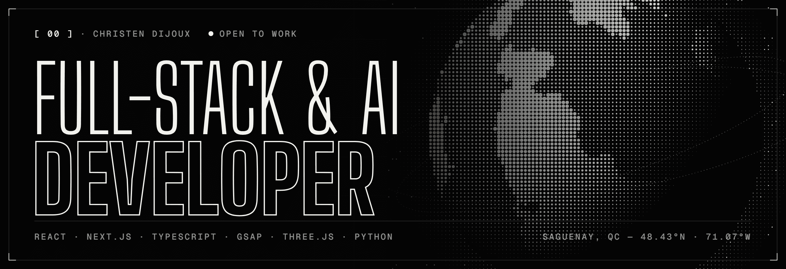
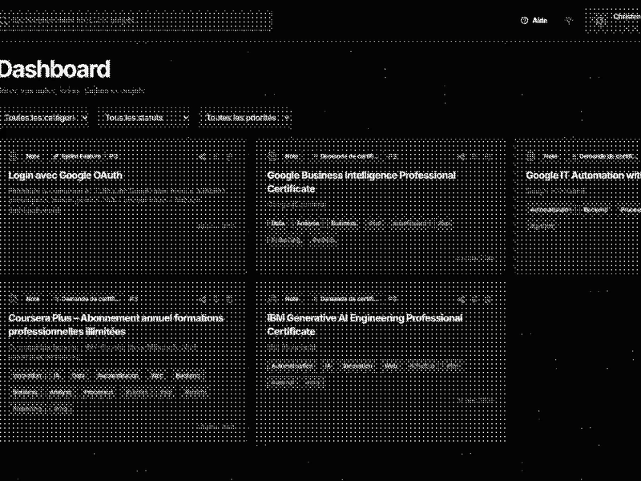
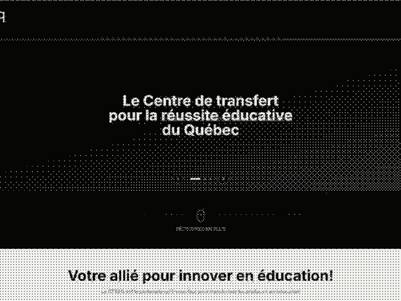
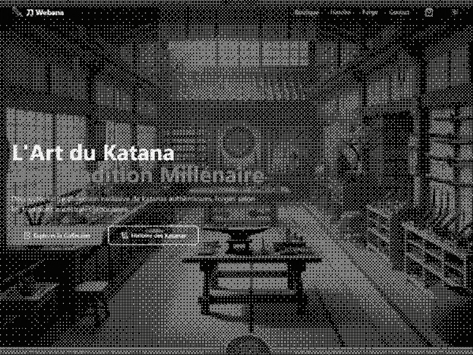
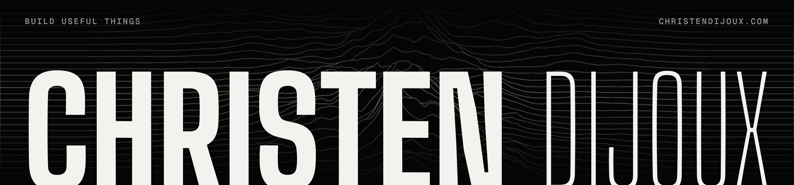

### `[ 01 ]` &nbsp; Index

I'm **Christen Dijoux** — full-stack developer & creative technologist based in **Saguenay, Québec**, originally from **La Réunion**.

I build two kinds of things: **web experiences** where motion, WebGL and typography meet solid engineering, and **internal platforms** that connect business data, automation and applied AI. By day, Digital Innovation Specialist & full-stack developer; on the side, founder of **Synaptia Web**.

<table>
<tr>
<td width="33%" valign="top">01 · BUILD <b>Full-stack apps</b> Internal & public products with React, Next.js, TypeScript, Node.js and Python.</td>
<td width="33%" valign="top">02 · AUTOMATE <b>AI & integration</b> LLMs, APIs, ERP and workflows wired into real operations — less manual work, cleaner data.</td>
<td width="33%" valign="top">03 · CRAFT <b>Creative web</b> Headless architectures and animated, accessible interfaces — GSAP, Three.js, shaders.</td>
</tr>
</table>

### `[ 02 ]` &nbsp; Selected work

<table>
<tr><td width="50%" valign="top"> [ 01 ] <b><a href="https://christendijoux.com/project/akiworkspace">AkiWorkspace</a></b> Productivity & knowledge workspace — modern UX, information architecture, AI features. <code>React · Next.js · TypeScript · AI</code></td><td width="50%" valign="top"> [ 02 ] <b><a href="https://christendijoux.com/project/ctreq">CTREQ</a></b> Headless platform — WordPress content model, Next.js front, GraphQL, cloud deployment. <code>Next.js · WPGraphQL · ACF · DigitalOcean</code></td></tr>
<tr><td width="50%" valign="top"> [ 03 ] <b><a href="https://christendijoux.com/project/innovations-numeriques-fp">Innovations Numériques FP</a></b> Interactive app for ECOBES & CTREQ showcasing 40+ teachers’ digital innovations — sector browsing, search, Mapbox map. <code>React · TypeScript · Vite · Mapbox</code></td><td width="50%" valign="top"> [ 04 ] <b><a href="https://christendijoux.com/project/webana">Webana</a></b> E-commerce concept around the art of the katana — filters, cart, light/dark modes. <code>React · Tailwind CSS</code></td></tr>
</table>

→ Full case studies on <a href="https://christendijoux.com/projects">christendijoux.com/projects</a>

### `[ 03 ]` &nbsp; Open source

| Repo | What it is |
| :-- | :-- |
| [**portfolio**](https://github.com/Akiyo974/portfolio) | This portfolio — React, GSAP, Three.js dithered shader, PHP leaderboard. [Live ↗](https://christendijoux.com) |
| [**BlueDistrict**](https://github.com/Akiyo974/BlueDistrict) | 3D LinkedIn-powered city game where your activity lights up your district in real time. |
| [**Autocliker-by-colors**](https://github.com/Akiyo974/Autocliker-by-colors) | Multi-colour autoclicker with HSV detection, GUI & CLI — Windows. |
| [**webana**](https://github.com/Akiyo974/webana) | Katana e-commerce concept in React & Tailwind. [Live ↗](https://akiyo974.github.io/webana/) |
| [**square-image-cropper**](https://github.com/Akiyo974/square-image-cropper) | Small Python GUI tool to crop images to square. |

### `[ 04 ]` &nbsp; Recently shipped

<!--START_SECTION:shipped-->
| Repo | What | Stack | Last push |
| :-- | :-- | :-- | :-- |
| [**portfolio**](https://github.com/Akiyo974/portfolio) [↗](https://christendijoux.com) | Monochrome portfolio — dithered WebGL, kinetic type, a Lab that dissects every component… | `TypeScript` | today |
| [**Mona-Game**](https://github.com/Akiyo974/Mona-Game) [↗](https://akiyo974.github.io/Mona-Game/) | Fort Mason Octodex: catch all 12 GitHub Octocats around San Francisco's Fort Mason and wi… | `Python` | today |
| [**badger**](https://github.com/Akiyo974/badger) [↗](https://akiyo974.github.io/badger/) | Apps for the GitHub Universe '26 badge and Badge Studio, an app store for it that runs in… | `Python` | yesterday |
| [**portfolio-watch**](https://github.com/Akiyo974/portfolio-watch) [↗](https://christendijoux.com) | Portfolio de Christen Dijoux en version Galaxy Watch — app Wear OS en Kotlin et Jetpack C… | `Kotlin` | 5 days ago |
| [**BlueDistrict**](https://github.com/Akiyo974/BlueDistrict) | 3D LinkedIn-powered city game where your professional activity grows and lights up your d… | `TypeScript` | Jun 2026 |
<!--END_SECTION:shipped-->

### `[ 05 ]` &nbsp; Stack

<table>
<tr><td><b>FRONTEND</b></td><td>     </td></tr>
<tr><td><b>MOTION / 3D</b></td><td>     </td></tr>
<tr><td><b>BACKEND</b></td><td>      </td></tr>
<tr><td><b>DATA</b></td><td>   </td></tr>
<tr><td><b>CMS</b></td><td>   </td></tr>
<tr><td><b>AI / AUTOMATION</b></td><td>   </td></tr>
<tr><td><b>CLOUD / OPS</b></td><td>     </td></tr>
<tr><td><b>CREATIVE</b></td><td> </td></tr>
</table>

<!--START_SECTION:waka-->
<!--END_SECTION:waka-->

### `[ 06 ]` &nbsp; Now exploring

`Rust` high-performance services &nbsp;·&nbsp; `AI agents` multi-agent workflows &nbsp;·&nbsp; `Data automation` business data → decisions &nbsp;·&nbsp; `Architecture` scalable integrations &nbsp;·&nbsp; `Security` app & infra

 

> **Build useful things. Automate what shouldn't be manual. Make complex systems feel simple.**

Open to collaborations & freelance · <a href="mailto:christen.dijoux@gmail.com">christen.dijoux@gmail.com</a> · <a href="https://buymeacoffee.com/christendijoux">Buy me a coffee ☕</a>

